# Lobu concepts — entities, events, and the run lifecycle

Read this first: the mental model in one screen, then the end-to-end lifecycle,
then the feature map. `AUTOMATIONS.md` holds the Automation primitive contract;
`connector-authoring.md` holds the connector contract.

## Mental model

- **Events are the durable knowledge and event record.** An event is an
  immutable, append-only row in the `events` table describing one thing that
  happened at one point in time: a GitHub PR, a webhook delivery, a knowledge
  save, or an Automation output. Nothing is deleted. Corrections write a new event
  that **supersedes** the old one. Chat transcripts are durable too, but live in
  `channel_messages`, not `events`.
- **Entities are typed, current-state records linked to events.** An entity is
  an instance of a declared entity type (for example, `ticket`) with typed
  properties. Current values live on the entity row; linked content events and
  append-only change events preserve its evidence and update history. Entities
  are not a read-time fold over the event log.
- **Identity has two layers.**
  - `origin_id` — the source platform's stable id for an item, scoped to its
    connection. This is cross-sync identity: re-syncing the same GitHub issue
    keeps the same `origin_id` even when the stored row id changes.
  - `events.id` — the stored-version id of a row. A resync that supersedes the
    prior row allocates a new `events.id`. Never use it as source identity.
  - `supersedes_event_id` — points at the event a new event replaces. The old
    row stays in history but is hidden from normal reads. Automation windows
    and SQL using their `window_token` select event versions as of the window
    end; ordinary reads use the masked `current_event_records` projection.
- **Automations turn events into work.** An Automation is a versioned task owned by
  an agent: a trigger decides when a run starts, prompt/skills decide what the
  agent does, sources bound what it may read, outputs declare what a completed
  run persists. See `AUTOMATIONS.md`.

## Source-backed records and relationships

Stored records use a positive integer `entity_id`. A source-backed type declares
its durable projected key with root `metadata_schema: { "x-lobu-record-key": "id" }`.
Its records use a verbatim string `entity_id` plus `entity_type`; even `"007"`
stays a source key. Views without that declaration return `id: null` and remain
read-only views. Reads never create stored rows.

Declared keys use `exactMatch.verbatim: true` on connector queries. A connector
must advertise both `queryCapabilities.exactMatch` and `queryCapabilities.verbatimExactMatch`;
unsupported sources reject the lookup before executing it. Legacy view slugs
retain trimmed matching.

Reference selectors also accept a discovered numeric entity-type ID. A string
type slug resolves only in the current workspace; a numeric type ID identifies
one exact schema and derives its owner. Private authored relationships may
target public source-backed types, with live reads limited to the target's
public visitor projection: no workspace role, no private connection, and no
paired device. The caller's agent read restrictions still apply, and this
grants no permission to switch execution workspaces. An edge belongs to the
workspace that authored it: `listLinks` on another workspace's public record
returns only the caller's own edges, and rows link foreign endpoints to their
owner's page (`from_entity_url`/`to_entity_url`). Persisted references retain
type IDs, not re-resolved names; retiring a type cannot retarget old edges to a
reused slug. A publisher may delete or rewrite the backing of a type other
workspaces cite (their edges are then withheld or read the new rows), but its
record key cannot change while any live edge names it: create a new type
instead. A numeric type ID is specific to one database: a portable
`lobu.config` names types by slug, and a caller discovers IDs at runtime.

`get` and `listLinks` accept either reference. `link`, `unlink`, and `updateLink`
accept `from_entity_id`/`to_entity_id`, with `from_entity_type`/`to_entity_type`
required for strings. Ordinary relationships support every stored/source pair.
Only the assertion is stored in `entity_relationships`, using type IDs and keys
for source endpoints; source fields stay at their source. System authorization
and identity-group edges still require stored records. `entity_identities`
continues to hold source identity claims, independently of these business edges.

Both endpoints must be readable to disclose an authored edge. Unavailable
endpoints are withheld with key-free `relationship_failures`; readable links stay
available. Updating an edge requires readable endpoints; unlink by ID remains available
without contacting the source. Page counts describe visible results, not global
totals. A page may be empty while more candidates remain. A source page rejects
`source`, `confidence_min`, and `include_deleted` filters, which cannot apply
to live links. Source reads share a 20 second deadline per page. Source-owned links
remain live, read-only `record_links`; authored assertions are `relationships`.
`listLinks` with `record: {type, key}` reads a declared-key type exactly like
`entity_id` plus `entity_type`; views without a declared key keep their
source-native read.
Raw SQL and schema table relationship columns expose stored-endpoint edges only;
federated reads go through the entity API. Backing/key edits and type deletion
require unlinking live source edges first. Their conflict returns up to 25 blocking
relationship IDs for owner/admin cleanup, even when the source is unavailable.
No source row is copied or refreshed.

## Entity identity groups

A workspace can declare a relationship type with `purpose: "identity"` for its
stored entity types. Linking two current roots associates their records and
makes the target the representative. Each record keeps its ID and metadata;
unlinking an edge splits off its source subtree. There is no new permanent
person ID.

Participating live records expose `identity: { root_id, member_ids }` on reads.
`member_ids` is sorted and bounded to 26 records; `root_id` is the current
representative and can change. Persist record IDs when referring to a record.

- `entities.get`, updates, deletes, and `listLinks` address the exact record.
- `entities.list` returns one representative per group. One member must satisfy
  the complete set of search, parent, attribute, and segment filters; display
  fields and sort order come from the representative.
- `knowledge.search` returns the strongest matching member once per group,
  before applying the result limit. Its metadata remains that member's own.
- Entity-scoped history and content counts include the group's visible events,
  retaining source permissions and identifier scope. Connection, child, and
  assigned Automation counts continue to describe the exact record.

Identity decisions evaluate every member on both sides. Composite identifiers
must come from one record; a match cannot combine fields from different members.
A conflicting unique identifier anywhere in either group requires review, and
write policies apply to every affected member. Approvals recheck the current
members, normalized evidence, policy, and original requester's access.

Rejections and withdrawals retain their original member pairs when roots change.
Unchanged or reduced support stays suppressed. New normalized evidence can queue
fresh human review; an explicit human reconsideration also requires a new
approval that identifies the prior decisions.

`link` and `unlink` results distinguish applied changes, queued approvals,
suppression, and dry-run previews. Only an applied link returns `relationship`;
only an applied unlink returns `success: true`.

Ordinary relationships and system authorization edges do not form these groups.
Reserved, derived, source-backed, deleted, and nonparticipating records have no
identity descriptor. Identity associations retain the original records and history;
physical merge, redirect, and undo operations are retired.

The entity SDK has ten named methods: `discoverDuplicates`, `list`, `get`,
`create`, `update`, `delete`, `link`, `unlink`, `updateLink`, and `listLinks`.
Use `entity_id` and `entity_type` in their inputs. Schema-defined fields belong
in `metadata`; filter them with `filters`. There are no `manage` or `search`
aliases or implicit field shortcuts.

Duplicate discovery requires one applicable active relationship with
`purpose: "identity"` and explicit `x-lobu-resolution.rules` on the entity type.
Each rule names `fields`, a normalizer (`email`, `phone`, or `exact`), and
`onMatch: "auto_link"` or `"review"`. No entity type receives implicit rules.
Discovery proposes at most one current root pair per whole matching component;
apply it with `link` and rediscover after each join. Groups retain up to 26
records. Preview, queued, suppressed, and applied receipts are distinct.
Record-level read policies withhold an entire group when any member is denied;
source permissions still govern history.

The physical-merge redirect column and its execution helpers are removed.
Upgrading from 21.2.1 retires any remaining redirect inside the upgrade: event
and other references move to the survivor and the tombstoned duplicate is
deleted (`docs/MIGRATIONS.md`, "Retiring physical entity merges"). Active merge
ledgers are deleted; undone ledger snapshots remain audit-only and do not
support undo. Authentication identity provenance on retained identities is
preserved.

## The event lifecycle (end to end)

```mermaid
flowchart LR
  A["Connector feed sync"] --> B["EventEnvelope (origin_id, origin_type)"]
  B --> C["events row (append-only; dedupe by connection + origin_id)"]
  C --> D["Trigger match (connector eventKinds / schedule / workspace output)"]
  D --> E["Run queue (window or turn; queue or coalesce)"]
  E --> F["Automation execution (governed sources + exact event pointers)"]
  F --> G["Declared outputs (entity rows / append-only events)"]
  G --> H["Downstream workspace-triggered Automations (chaining)"]
```

1. **Ingest.** A connector feed sync lands rows in `events`. Named event
   attributions may also materialize connector-declared entity relationships in
   the same event transaction; each relationship claim is owned by the event's
   `(connection_id, origin_id)`, so resync and connection deletion retract only
   the source facts they own. Generic webhook deliveries also land there; chat
   messages instead persist in
   `channel_messages` and are normalized into connector turn signals. Connector
   event ingestion dedupes by `(connection_id, origin_id)`; a row whose current
   head is unchanged is not a new source item.
2. **Match.** The platform checks active Automation triggers. Connector triggers
   use the connector's resolved event catalog (declared `automationEvents` in the
   connector definition — persisted in the catalog as `automation_events` — else
   its feed `eventKinds`). For feed-derived triggers, the first successful
   non-dry sync establishes a baseline; later inserted items activate their kind.
   Kinds with `updatedEvent: true` also emit `<kind>.updated` when a supersede
   carries strictly newer `occurred_at` activity. Unchanged and volatile-only
   updates stay quiet.
   Workspace triggers fire only on **newly persisted declared event outputs**
   from another Automation. Ordinary knowledge saves and connector-ingested
   events do not activate workspace-source triggers; connector events activate
   only matching connector-source triggers. Schedules match by cron.
3. **Run.** The matched Automation's run is queued and claimed. A **window** run
   reads its bounded data window; a **turn** run processes one delivery.
   `queue` keeps activations separate; `coalesce` merges pending inputs up to
   the safety limits in `AUTOMATIONS.md`.
4. **Persist.** A completed window may persist declared **outputs**: entity
   rows (upsert by a key) and/or append-only events. Persisting an event output
   atomically queues activation of downstream `source: "workspace"` Automations —
   that is how automations chain.

Source-only observers can also retain metadata-only change references under an
active Automation's explicit `capture: "references"` consent. Acceptance and
source checkpoint advancement commit together, independently of agent execution.
External clients read those append-only observations through
`knowledge.read({automation_id, view:"changes", cursor})`, each maintaining its
own cursor. This read neither creates a run nor advances shared processing
progress. Initial provider scans and entity identity decisions remain separate
existing operations; references alone do not import bodies or merge entities.

## Feature map

| Layer | What it does | Where it lives |
|---|---|---|
| Connector | Pulls from an external source via feeds; executes write-back actions | built-ins in `packages/connectors/src/*.ts`; custom via `connectors/*.connector.ts` |
| Feed | One sync source inside a connector; uses checkpoints; declares `eventKinds` | declared in the connector definition |
| Event | Immutable append-only row; the bus between ingest, triggers, and chaining | `events` table; read via `current_event_records` |
| Entity | Typed current-state projection of linked events | `defineEntityType` schema; `entities` rows |
| Agent | Identity + persona + skills; owns Automations | `agents/<id>/` (`IDENTITY.md`, `SOUL.md`, `USER.md`); `defineAgent` |
| Automation | Triggered task owned by an agent; reads governed sources, persists outputs | `defineAutomation` |
| Interaction surface | Where people talk to the agent: Web UI, API/SDK, MCP, chat platforms | built-in Web/API/MCP; chat via `defineConnection` |

## Webhook connections (push sources)

A connection with connector `webhook` turns any external system that POSTs JSON
(Sentry, GitHub, Stripe, CI) into a push source: the delivery lands as an
`events` row. Subscribe an Automation to the connector event
`delivery.received` for immediate processing, optionally filtering on the
configured `semantic_type`; scheduled and manual Automations can still process
the same durable rows through bounded SQL sources.

- **Deliver:** `POST <gateway>/lobu/api/v1/webhooks/<connectionId>` with
  `Authorization: Bearer <token>` (or `?token=` when `allowQueryAuth` is on).
  Public create/apply requires a non-numeric connection slug and a bearer token
  of at least 32 characters; the slug is the `<connectionId>` in this route.
- **Config:** caller-supplied `token`, `allowQueryAuth`,
  `dedupeHeader` (the provider's delivery-id header; the default idempotency key
  is `sha256(raw body)`), `semanticType`, `titlePath` (JSON pointer → `title`),
  `searchable` (render `payload_text` for semantic recall).
- **Delivery contract:** `202 {"ok":true,"id":<eventId>}` on persist;
  redeliveries return the existing id; `413` over 256 KB; `400` non-JSON;
  `429` over 120 authenticated deliveries/min per connection. Dedupe is a
  partial unique index on `(organization_id, connector_key, origin_id)`.
- **Read back:** scheduled or manual Automation SQL sources select
  the connection by `connection_id` and read the verbatim payload from
  `payload_data`. The legacy `connector_key = 'webhook:<runtimeConnectionId>'`
  remains available for compatibility and is required for deliveries ingested
  before connection-scoped webhook projection shipped. Object-root JSON is
  stored directly; array or primitive roots are wrapped as `{"payload": ...}`.

## Reading and writing data (agent-facing)

- `search_memory` / `save_memory` — recall and persist semantic knowledge;
  pass `supersedes_event_id` to replace a stale fact.
- `query_sdk` / `query_sql` — governed read-only access.
- `run_sdk` — mutations and external operations.
- `client.entities.create/update` — strict structured rows matching a declared
  entity schema; `client.knowledge.save` — schema-less history.
- Never `DELETE FROM events`; supersede or tombstone instead.
