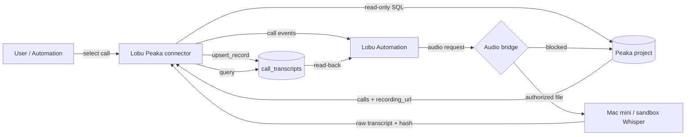

# Peaka connector

The `peaka` connector puts a Peaka project behind Lobu's normal connector
contract: governed reads, a scheduled feed, API/Webhook flow invocation, and
idempotent writes into Peaka internal tables. It talks only to Peaka's
documented Partner API; it never receives a ServiceTitan credential.

## What it does

| Capability | Operation | Transport |
|---|---|---|
| Read-only SQL | `query` | `POST /data/projects/:project/queries/execute?format=SIMPLE` |
| Metadata | `list_tables` | internal-table or catalog/schema table listing |
| Append one row | `add_record` | CSV import (`/table/:table/import`) |
| Idempotent write | `upsert_record` | read by key → no-op / CSV import / configured flow |
| Invoke a flow | `invoke_flow` | `POST` to a configured `*.peaka.studio` API & Webhook URL |
| Scheduled rows | `calls` feed | user-authored read-only SELECT + checkpoint |
| Inbound webhook | `registerWebhook` | manual setup descriptor + signing secret |

The feed's event kind is `call`, with `call_id`, `duration`, `status`,
`recording_url`, and `project_id` metadata. An Automation can subscribe to it
through the normal feed event catalog.

## Authentication and configuration

Create a **project-scoped API key** in Peaka Studio → Project Settings → API
Keys. The key is a Bearer token for `https://partner.peaka.studio/api/v1` (or
the EU base URL). Store it as the connection's `env_keys` profile:

- `PEAKA_API_KEY` (secret, required)
- `PEAKA_PROJECT_ID` (required)
- `PEAKA_BASE_URL` (optional, defaults to the US Partner API)
- `PEAKA_UPSERT_FLOW_URL` (optional, Peaka API & Webhook URL)
- `PEAKA_FLOW_TOKEN` (optional, Bearer token for that flow)

The key and token never appear in action output, logs, or the connector's
`output`. The connector refuses action input that tries to name another
project; the project comes from the connection.

## Read boundary

`query` accepts exactly one statement starting with `SELECT`, `WITH`, `SHOW`,
`DESCRIBE`, or `EXPLAIN`. Additional statements are rejected before a request.
Peaka's query engine independently rejects DML (`Statement type 'Update' is
not allowed`), so this is defence in depth, not the write seal.

## Write path and the row-update gap

Peaka's documented Partner API can create an internal table, add columns, and
import CSV. It has **no row-update or row-delete endpoint**, and CSV import
appends. `upsert_record` therefore:

1. reads the row by `key_columns` (default `["idempotency_key"]`);
2. returns `action: "noop"` when every supplied field already matches;
3. imports one CSV row when absent and reads it back to verify;
4. when a row exists with different values, calls `PEAKA_UPSERT_FLOW_URL`
   with `{action:"update", table, key_columns, record, existing}`;
5. without that flow, returns
   `output.code = "peaka_update_unsupported"` rather than appending a
   duplicate.

The flow is Peaka-owned: its "Update a record" node selects by the key and
updates the columns. This keeps Peaka's native write semantics in Peaka and
avoids duplicating them in Lobu.

Reproducer for the gap (no secrets):

```bash
# 1. write a row through the connector (insert path)
# 2. change one value for the same idempotency_key and write again
# expected: success=false, output.code=peaka_update_unsupported
```

## Webhooks and feeds

Peaka has no webhook-registration API and API & Webhook flows cannot compute an
HMAC. `registerWebhook` therefore returns:

- a per-connection signing secret,
- the exact callback URL,
- `mode: "manual"` setup instructions.

A relay that can compute `HMAC-SHA256(secret, rawBody)` and send
`x-peaka-signature` can deliver to the normal route
`/lobu/api/v1/webhooks/:connectionId`. `unregisterWebhook` is a no-op because
nothing was created provider-side.

Until that relay exists, the supported no-code path is a Peaka API & Webhook
flow whose HTTP Request node posts to a Lobu **`webhook` connection** (bearer
token, dedupe header). The connector's `calls` feed remains the polling path.

## Audio / binary boundary (blocked)

Peaka is the ServiceTitan credential boundary: its connection holds the tenant,
client ID, and `ST-App-Key`, and the ServiceTitan recording reference is a
relative path such as `/telecom/v2/tenant/<tenant>/calls/<id>/recording`.
The documented Partner API exposes no file/artifact download or recording
endpoint; its export endpoints are CSV/JSONL only. Peaka's HTTP/flow response
surface is string-oriented, so byte safety for audio is unproven. Copying
`ST-App-Key` into Lobu or a test fixture would break the boundary.

Consequence: the connector exposes `recording_url` metadata but deliberately
does **not** fetch audio. The demo's audio step needs one of:

1. **Peaka gap fix (preferred):** a Peaka file/artifact endpoint that fetches a
   ServiceTitan recording server-side and returns bytes with content type,
   length, and (ideally) a short-lived URL.
2. **Separate ServiceTitan bridge:** its own authorized connection, documented
   as a distinct credential holder, which writes the audio to an artifact store
   the Mac mini/sandbox can read.

Neither path is claimed as working in this change.

## Demo runbook

Prerequisites: the universal connector-callback fix (registered webhooks must
point at the gateway mount), a Peaka project API key, and a Peaka internal
table. Use isolated names/rows and clean them up.

```bash
# 1. verify the connector reads the selected row
lobu call run_sdk --org <org> --arg title='Peaka read' --arg script='
export default async (_ctx, client) =>
  client.operations.execute({
    connection_id: <peaka_connection_id>,
    operation_key: "query",
    input: { sql: "SELECT CAST(id AS VARCHAR) AS call_id, duration, recordingurl FROM servicetitan.telecom.calls WHERE id = <call_id>" },
  });'

# 2. create a feed on the connector (bounded query)
#    feeds.create({ connection_id, feed_key: "calls",
#      config: { query: "SELECT ... ORDER BY createdon DESC LIMIT 20" } })
#    feeds.trigger({ feed_id })

# 3. transcribe on the Mac mini / sandbox (audio supplied by the bridge)
python3 run_call.py --audio <authorized_local_audio> \
  --project <peaka_project_id> --tenant <tenant_id> --call <call_id> \
  --environment integration

# 4. write the raw transcript through the connector (idempotent)
#    operations.execute({ operation_key: "upsert_record", input: {
#      table: "call_transcripts",
#      record: { tenant_id, call_id, audio_sha256, raw_transcript,
#                transcript_sha256, model, processed_at, status,
#                source_ref, attempt, idempotency_key } } })

# 5. read back exactly
#    operations.execute({ operation_key: "query", input: {
#      sql: "SELECT ... WHERE idempotency_key = '<key>'" } })
```

The runner's idempotency key is
`sha256(canonical JSON of project, environment, tenant, call, audio hash,
model hash, language, runner version)`. Re-running the same audio returns the
cached transcript; re-running the write returns `noop`.

## Verification status

| Check | Status |
|---|---|
| Real Peaka read (`servicetitan.telecom.calls`, test call) | proven via installed connector |
| CSV insert + exact read-back, including quotes/newlines | proven via installed connector |
| Repeat write is a no-op | proven |
| Changed-row update | intentionally blocked until `PEAKA_UPSERT_FLOW_URL` points at a working Peaka flow |
| Feed sync, checkpoint, no duplicate events | proven (5 events, second run emitted 0) |
| Local Whisper transcription + cache | proven on a public sample (11s audio, ~2.2s cached run) |
| Real ServiceTitan recording bytes | **blocked** by the Peaka binary/credential gap above |

## Diagram


